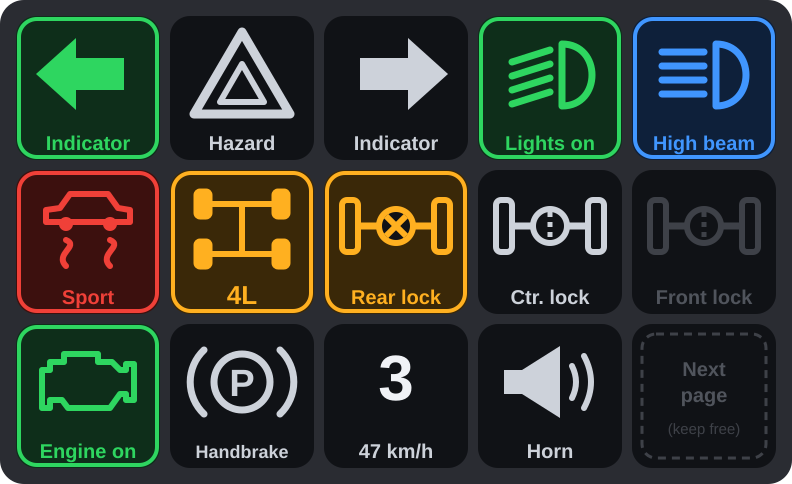
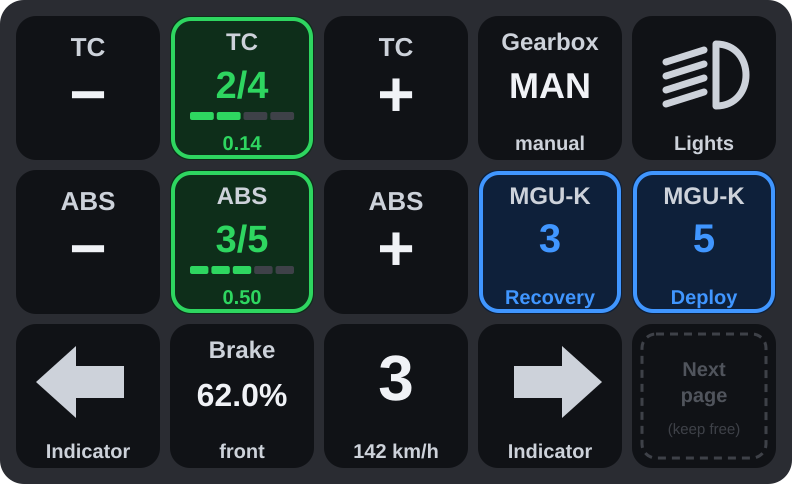
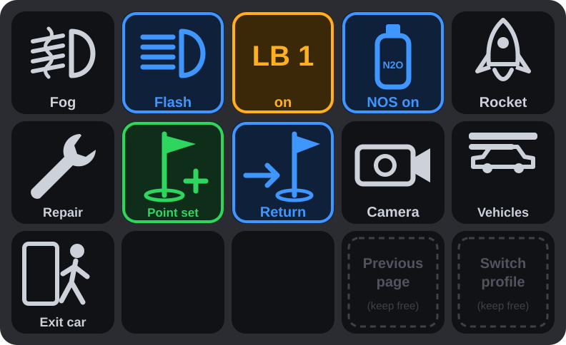
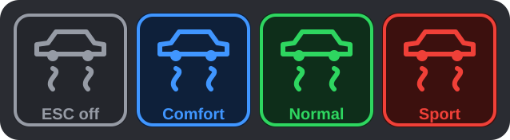
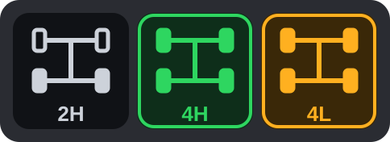
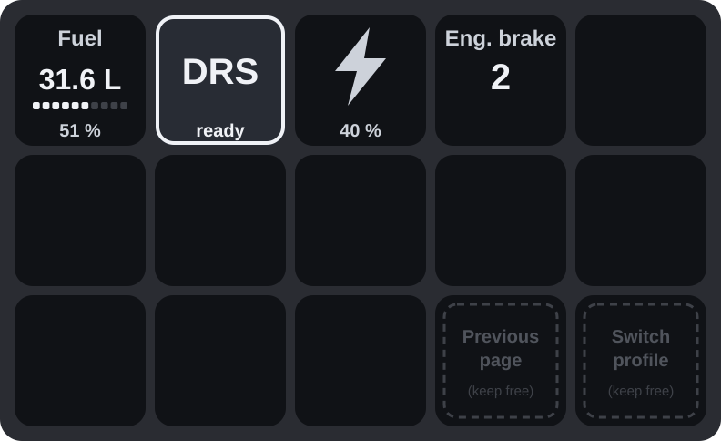
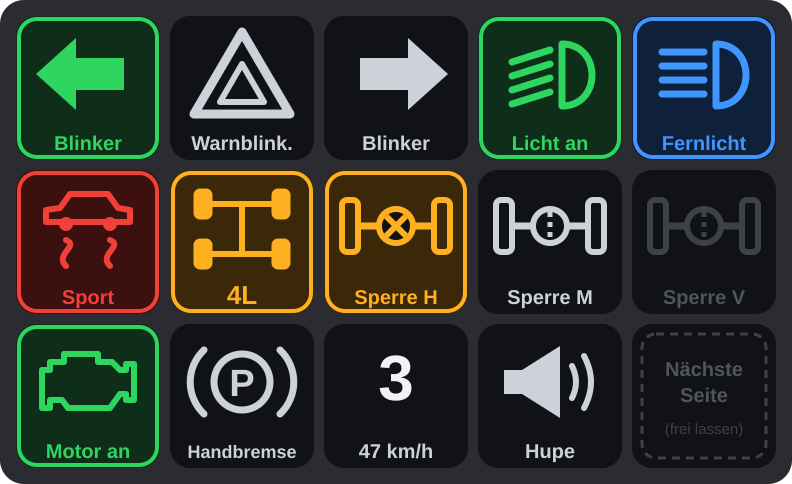

<p align="center">
  
</p>

<h1 align="center">SimDeck – BeamNG.drive & Assetto Corsa for Stream Deck</h1>

<p align="center">
  Live keys with real status display for <b>BeamNG.drive</b> and the original <b>Assetto Corsa</b>.<br>
  Lights, indicators, ESC mode, 2H / 4H / 4L, diff locks, TC / ABS levels and much more –<br>
  you see at a glance what is on, and features a car doesn't have are greyed out.
</p>

<p align="center">
  <a href="https://github.com/HerbertHorst/BeamNG-StreamDeck-Plugin/releases/latest"><b>⬇ Download the latest release</b></a>
</p>

---

## Contents

- [What it does](#what-it-does)
- [Installation](#installation)
- [Setting up the keys (one time)](#setting-up-the-keys-one-time)
- [All keys](#all-keys)
- [Language: English / German](#language-english--german)
- [Assetto Corsa notes](#assetto-corsa-notes)
- [Troubleshooting](#troubleshooting)
- [How it works](#how-it-works)
- [Building and releasing](#building-and-releasing)

---

## What it does

<p align="center">
  
  
</p>

- **Plug and play:** works with the default settings of both games. In BeamNG the keys trigger the
  game's own actions directly, so your keyboard bindings don't matter.
- **Live status:** every key shows the current state – indicator blinking, high beam on,
  ESC mode with its name and colour, 2H / 4H / 4L, locks engaged, TC level 2 of 4 …
- **Greyed out when not available:** no low range, no front locker, no nitrous on this car? The key is grey.
- **One layout for both games:** the same 15 keys switch automatically to the game that is running.
- **Two pages:** main functions on page 1, more on page 2, with fixed slots for page navigation and
  a "back to my default profile" key.
- **English and German.**

Made for the standard **Stream Deck with 15 keys (5 × 3)** on **Windows**.

---

## Installation

Download both files from the [latest release](https://github.com/HerbertHorst/BeamNG-StreamDeck-Plugin/releases/latest).

### 1. Stream Deck plugin

Double-click **`SimDeck.streamDeckPlugin`** and confirm in the Stream Deck app.
Updates are installed the same way – just double-click the new file.

### 2. BeamNG.drive mod

1. In the BeamNG launcher click **"Open user folder"** and open the **`mods`** folder.
2. Put **`simdeck_beamng_vX.Y.Z.zip`** into it **as it is – do not unzip it.**
3. Remove older `simdeck_beamng*.zip` files and an `unpacked/simdeck_beamng` folder if there is one.
4. Restart BeamNG.

You do **not** need to enable OutGauge – the mod has its own connection.

### 3. Assetto Corsa

**Nothing to install.** The plugin reads AC's shared memory directly (using the PowerShell that comes
with Windows). Starting AC through **Content Manager** or Steam both work, Custom Shaders Patch is fine.

---

## Setting up the keys (one time)

The plugin brings one action called **"SimDeck Key"**. Each copy of it picks its function by itself,
depending on **where it sits** and **which game is running**.

1. In the Stream Deck app create a new profile (e.g. "Sim Racing").
2. Drag **SimDeck → SimDeck Key** onto the top-left key.
3. Copy it (right-click → Copy, or Ctrl+C) and paste it onto the other keys of page 1.
   **Leave the bottom-right key free** and put the built-in **"Next Page"** action there.
4. Create a second page. Put a SimDeck Key on it, set **Layout page → Page 2** in its settings,
   then copy it onto the other keys of that page (the setting is copied along).
5. On page 2 put the built-in **"Previous Page"** and **"Switch Profile"** actions on the two slots
   marked *keep free* (bottom right). "Switch Profile" takes you back to your default profile.
6. Optional: in the profile settings link the profile to `BeamNG.drive.x64.exe` and `acs.exe`
   so the Stream Deck switches to it automatically when a game starts.

> Want a different arrangement? Click any key and choose a fixed **Function** instead of
> "Automatic". Every function can be placed anywhere.

---

## All keys

### BeamNG.drive

| Page 1 | Page 2 |
|---|---|
|  |  |

| Key | What it does | Status shown |
|---|---|---|
| Indicator left / right, Hazard | toggles | blinks in sync with the car |
| Lights, High beam, Fog, Flash | toggles / flashes while held | on / off |
| **ESC** | cycles the ESC / drive modes like Ctrl+Q | mode name and colour (see below) |
| **Drivetrain** | like Alt+S – on most 4×4s cycles 2H → 4H → 4L | **2H / 4H / 4L** |
| Rear / Ctr. / Front lock | locks / unlocks that differential | engaged = amber |
| Engine | start (hold) / stop | running, ignition |
| Handbrake, Horn | toggle / while held | on / off |
| Gear | display | gear and km/h |
| Lightbar, NOS, Rocket | lightbar mode, nitrous on/off, rocket/JATO **while held** | on / off, grey if the car has none |
| Repair | repairs the car where it is | |
| Set point / Return | saves a return point (like Ctrl+Home) / teleports there **and repairs** (like Home) | "Point set" once saved |
| Camera, Vehicles, Exit car | next camera, vehicle selector, enter / exit vehicle | |
| Range *(not in the automatic layout)* | High / Low only | HIGH / LOW |

**ESC colours and drivetrain display**


&nbsp;


Grey = ESC off, blue = comfort, green = normal, red = sport / track. The mode name appears after
you switch the mode for the first time in a car.

### Assetto Corsa

| Page 1 | Page 2 |
|---|---|
|  |  |

| Key | Default key in AC | Status shown |
|---|---|---|
| TC −, TC, TC + | Ctrl+Shift+T, Ctrl+T, Ctrl+T | TC level (see below) |
| ABS −, ABS, ABS + | Ctrl+Shift+A, Ctrl+A, Ctrl+A | ABS level |
| Gearbox | Ctrl+G | AUTO / MAN |
| MGU-K recovery / deploy | Ctrl+1 / Ctrl+2 | level (hybrid cars) |
| Engine brake | Ctrl+4 | setting |
| Brake bias, Gear, Fuel | display | % front, gear + km/h, litres + % |
| DRS | *set your key* | available / open |
| KERS | *set your key* | charge % |
| Lights, Indicators | *set your key* (indicators need Custom Shaders Patch) | – |

---

## Language: English / German

The plugin follows the language of your Stream Deck app: German if the app is in German, English
otherwise. To choose yourself, click any SimDeck key and change **Language** in its settings –
this applies to all keys.

<p align="center">
  
</p>

---

## Assetto Corsa notes

- **TC / ABS levels:** AC only reports the TC / ABS *value* (a slip-ratio limit), not the level
  number. The plugin learns the levels of each car while you cycle through them once – after that
  the key shows e.g. **2/4** with a bar. "Forget AC levels" in the key settings resets this.
- **Key bindings:** only change them in *Assetto Corsa: key bindings* (key settings) if you changed
  them in AC. Format: `ctrl+shift+t`, `alt+left`, `f5`, `[` …
- AC must be the **active window** (it is while you drive).
- Don't run Content Manager / AC **as administrator** – Windows would then block the key presses
  from the Stream Deck (the displays still work).

---

## Troubleshooting

Click any SimDeck key and press **Check connection** in its settings. It shows the plugin version,
whether the BeamNG mod sends data (and its version) and whether the AC bridge runs.

| Problem | Solution |
|---|---|
| Keys stay grey in BeamNG | Load a map **with a car** – in the menu there is nothing to show. Check that only **one** `simdeck_beamng*.zip` is in `mods` and restart BeamNG. |
| "BeamNG mod: never" | The mod isn't loaded: wrong folder, unzipped, or several versions. |
| A key does nothing in BeamNG | Press **BeamNG diagnostics**, quit BeamNG and look into `beamng.log` (user folder) for lines with `simdeck`. Please attach it to an issue. |
| "AC bridge: not running" | An antivirus may block PowerShell scripts. Check `simdeck.log` (see below). |
| AC values shown but keys do nothing | AC not in focus, or AC / Content Manager runs as administrator. |

**Log files**
- Plugin: `%APPDATA%\Elgato\StreamDeck\Plugins\de.simdeck.plugin.sdPlugin\simdeck.log`
- BeamNG: `beamng.log` in the BeamNG user folder (launcher → "Open user folder")

---

## How it works

```
 BeamNG.drive ── mod (Lua) ── UDP 47010 / 47011 ──┐
                                                  ├── Stream Deck plugin (Node.js) ── Stream Deck app
 Assetto Corsa ── shared memory ── acbridge.ps1 ──┘
```

- **BeamNG mod** (`beamng-mod/`): a game-engine extension talks UDP to the plugin on `127.0.0.1`.
  Commands trigger the game's own input actions (`toggle4WDStatus`, `toggleESCMode`, `saveHome`,
  `vehicle_selector` …, see the
  [default keyboard bindings](https://documentation.beamng.com/modding/input/default-keyboard-bindings/)),
  with fallbacks to the vehicle's controllers and powertrain devices. A vehicle extension reports
  the state ten times per second.
- **AC bridge** (`plugin/…/bin/acbridge.ps1`): reads `Local\acpmf_physics`, `acpmf_graphics` and
  `acpmf_static` and presses keys via `SendInput` with scan codes.
- **Plugin** (`plugin/de.simdeck.plugin.sdPlugin/`): plain Node.js without dependencies; draws every
  key as SVG.

### Project layout

```
plugin/de.simdeck.plugin.sdPlugin/   Stream Deck plugin (manifest, de.json / en.json, bin/, ui/, imgs/)
beamng-mod/                          BeamNG mod (lua/ge, lua/vehicle, scripts/)
tests/                               plugin tests (Node) and mod tests (Lua)
scripts/build.py                     builds the release files into dist/
scripts/render_previews.js           renders the images in docs/images/
VERSION, CHANGELOG.md                version number and release notes
```

---

## Building and releasing

```bash
node --test --test-concurrency=1 tests/*.test.js   # plugin tests (Node.js 20+)
lua5.4 tests/lua/run_tests.lua                     # BeamNG mod tests
python3 scripts/build.py                           # -> dist/
```

**Releases are automatic.** The GitHub Actions workflow tests and builds every push. On `main`,
when the number in [`VERSION`](VERSION) has no release yet, it creates the release
**v&lt;VERSION&gt;** with the plugin, the mod and the notes from [`CHANGELOG.md`](CHANGELOG.md).

To publish an update:

1. raise the number in `VERSION` (e.g. `1.5.0` → `1.5.1`),
2. add a `## 1.5.1` section at the top of `CHANGELOG.md`,
3. push to `main`.

To regenerate the README images: `node scripts/render_previews.js`, then convert the SVGs with
`rsvg-convert` (see the comment at the top of the script).

---

*BeamNG.drive is a trademark of BeamNG GmbH, Assetto Corsa of Kunos Simulazioni, Stream Deck of
Corsair / Elgato. This is an unofficial fan project.*
